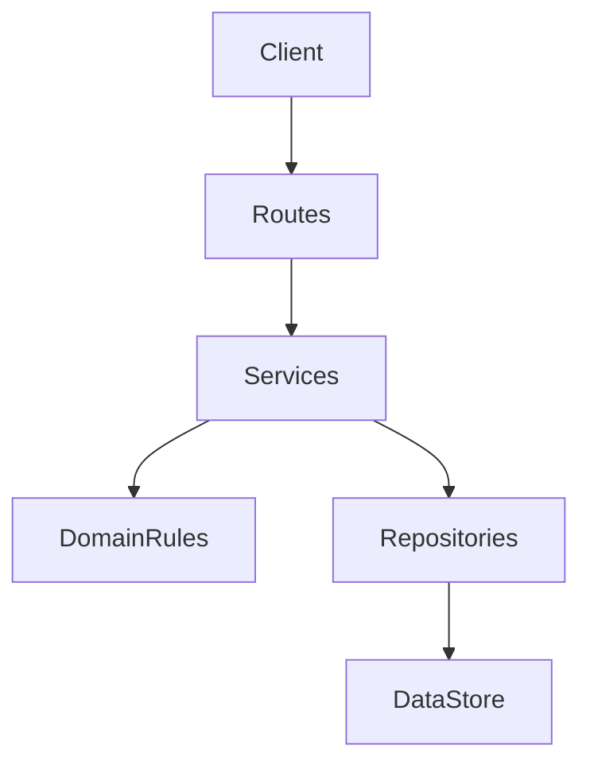
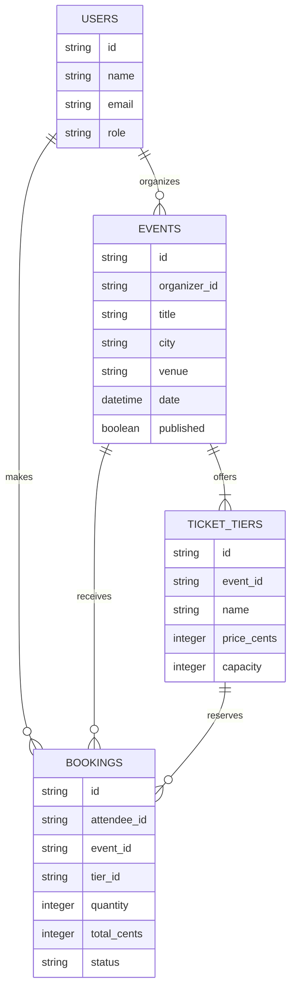
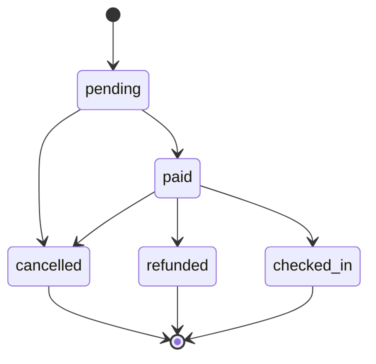

# Architecture

## Layers

- **Routes** may translate HTTP requests and responses, but may not implement business rules or access persistence directly.
- **Services** may coordinate domain rules and repositories, but may not depend on HTTP details or reach upward to routes.
- **Domain rules** may validate and enforce business invariants, but may not depend on services, routes, or storage technology.
- **Repositories** may read and write data, but may not decide business policy or call services and routes.

## Data model

## Booking life cycle

